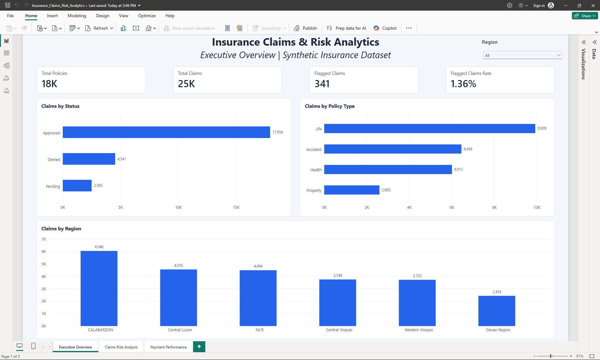
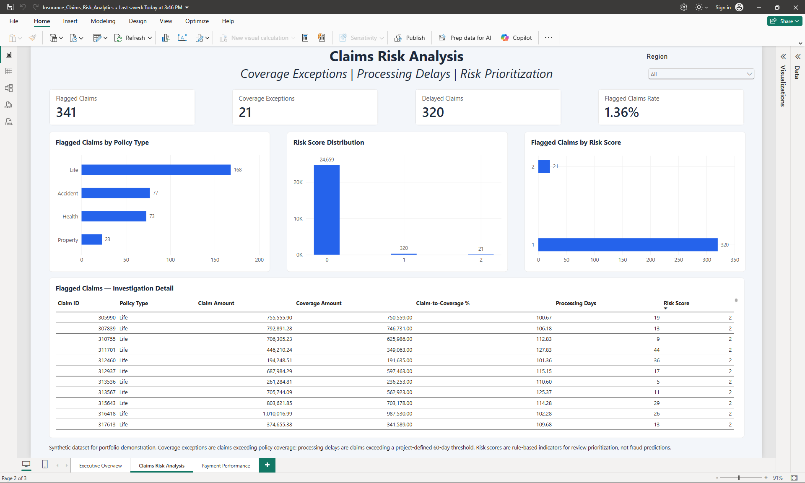
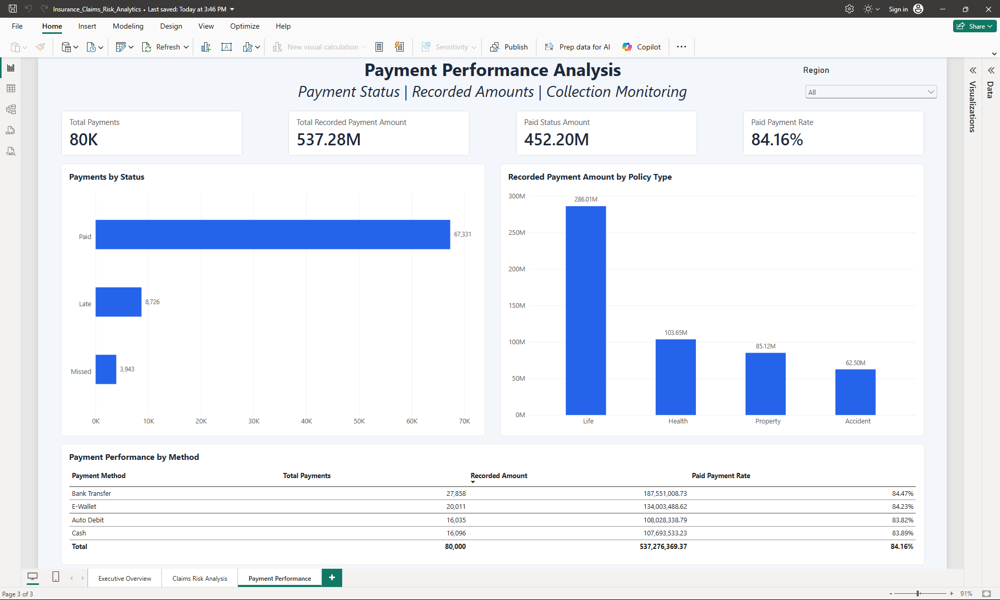

# Insurance Claims & Risk Analytics

A SQL and Power BI portfolio project analyzing **25,000 claims across a synthetic insurance dataset** to identify coverage exceptions, processing delays, and priorities for review.

The project applies an internal audit perspective to data analysis: check source-data quality, define transparent review rules, compare results across policy types, and communicate findings through reusable SQL views and a three-page Power BI report.

**Tools:** MySQL 8.0+, SQL, Power BI Desktop  
**Techniques:** joins, CASE-based flags, conditional aggregation, CTEs, percentage calculations, and `ROW_NUMBER()` window functions

## Results at a Glance

The documented project snapshot contains **10,000 customers, 18,000 policies, 25,000 claims, and 80,000 payment records**.

| Claims indicator | Result | Percentage of all claims |
| --- | ---: | ---: |
| Claims with more than 60 recorded processing days | 320 | 1.28% |
| Claims exceeding recorded policy coverage | 21 | 0.08% |
| Claims meeting both conditions | 0 | 0.00% |
| **Unique claims meeting either review rule** | **341** | **1.36%** |

Each flagged claim is counted once:

`21 coverage exceptions + 320 processing flags − 0 overlap = 341 unique flagged claims`

Percentages use the documented 25,000-claim population and are rounded to two decimal places.

## Business Questions

- Which claims require review because their amounts exceed recorded policy coverage?
- Which claims have more than 60 recorded processing days?
- How do flag counts and rates differ across policy types?
- Which claims rank highest by amount or claim-to-coverage percentage within each policy type?
- How are recorded payment amounts and records distributed across source statuses and payment methods?

## Business Relevance

The analysis demonstrates how claims data can support a focused review process:

- **Exception identification:** isolates 341 claims meeting at least one defined rule from a population of 25,000.
- **Review prioritization:** distinguishes coverage exceptions from processing flags and assigns transparent review scores.
- **Policy-type comparison:** reports both flag counts and rates so segments can be assessed relative to their claim volumes.
- **Targeted investigation:** ranks up to three claims per policy type by amount and, separately, by claim-to-coverage percentage.
- **Reporting consistency:** uses shared SQL views and documented metric definitions to support comparison between SQL outputs and Power BI indicators.

These are demonstrated analytical uses. The project does not measure actual reductions in losses, processing time, or review effort.

## Analytical Workflow

1. **Profile the data.** Inspect record counts, identifiers, missing values, categories, monetary values, dates, and table relationships.
2. **Prepare reporting views.** Apply selected customer-field standardization and create views for customer, policy, claims, and payment reporting.
3. **Analyze claims.** Calculate coverage and processing flags, overlap, review scores, policy-type rates, ratios, and rankings.
4. **Summarize payment activity.** Compare recorded payment counts and amounts by source status and payment method.
5. **Present and reconcile results.** Organize findings in Power BI and compare core claims indicators with SQL results.

Data-quality checks identify issues; their presence does not establish that every check passed. The views do not perform comprehensive data remediation.

## Review Rules

| Indicator | Definition |
| --- | --- |
| Coverage exception | `claim_amount > coverage_amount` |
| Processing flag | `processing_days > 60` |
| Unique flagged claim | Meets either rule; counted once |
| Review score | `2 × coverage_exceeded_flag + processing_delay_flag` |
| Claim-to-coverage percentage | `claim_amount / coverage_amount × 100` |

Scores range from 0 to 3. The 60-day threshold and 2:1 weighting are project-defined rules for review prioritization.

The analysis includes pending and denied claims. A flag does not establish fraud, an incorrect payout, or a contractual service-level breach. A zero score means neither rule was triggered; it does not establish that a claim is free of other risks or missing inputs.

## Power BI Report

### Executive Overview

Portfolio counts, recorded amounts, and headline claims review indicators.

### Claims Risk Analysis

Coverage exceptions, processing flags, review scores, and policy-type comparisons.

### Payment Performance

Recorded payment activity by source status and payment method.

Payment amounts describe recorded activity. Source labels such as `Paid`, `Late`, and `Missed` do not independently establish verified collections, overdue balances, or payment timeliness.

## Repository Guide

| File | Purpose |
| --- | --- |
| [Data-quality checks](sql/01_data_quality.sql) | Profile schema, counts, identifiers, missing values, categories, amounts, dates, and references |
| [Reporting views](sql/02_cleaned_views.sql) | Define reusable views and inspect their populations |
| [Claims risk analysis](sql/03_claims_risk_analysis.sql) | Calculate flags, scores, policy-type comparisons, ratios, and rankings |
| [Payment analysis](sql/04_payment_performance.sql) | Summarize recorded payments by status and method |
| [Methodology](documentation/methodology.md) | Explain analytical definitions, assumptions, and workflow |
| [Data dictionary](documentation/data_dictionary.md) | Describe tables, fields, relationships, and derived metrics |
| [Validation notes](documentation/validation_notes.md) | Document reconciliation benchmarks, evidence boundaries, and rerun controls |
| [Power BI report](powerbi/Insurance_Claims_Risk_Analytics.pbix) | Download the three-page report for Power BI Desktop |

## How to Explore

1. Start with the findings and dashboard screenshots.
2. Review the claims SQL and methodology to understand the rules and calculations.
3. To rerun the analysis, provide the matching populated MySQL 8.0+ database named `insurance_risk_analytics` and run the SQL files in order: **01 → 02 → 03 → 04**.
4. Inspect existing view definitions before running file 02, which uses `CREATE VIEW`.
5. Reconcile raw and analytical-view populations, distinct claim IDs, and review flags before interpreting results.
6. Open the `.pbix` in Power BI Desktop. Refresh requires the matching MySQL database and views, connection support, and valid local connection settings.

## Validation and Scope

The project owner ran the SQL in MySQL Workbench and reported matching reconciliation results. Core claims indicators were also reported as reconciled between SQL and Power BI. Detailed evidence boundaries and repeat-validation instructions are documented in the validation notes.

- The data is synthetic; findings demonstrate analytical methods rather than actual insurer performance.
- Review scores are descriptive rules, not a predictive fraud model or actuarial risk probability.
- Claims-to-policy joins require grain and relationship checks to prevent excluded or multiplied records.
- Claim-to-coverage percentages are not premium-based insurance loss ratios.
- Payment reporting does not establish collection efficiency or overdue aging without billing and settlement definitions.
- Database setup, data-generation/import scripts, and a reproducible seed are not included. A repository checkout alone cannot recreate the source dataset.

## About This Project

This independent portfolio project extends my internal audit and Excel-based data analytics experience into SQL analysis and Power BI reporting. It demonstrates how I approach data validation, exception analysis, review prioritization, and communication of findings.
