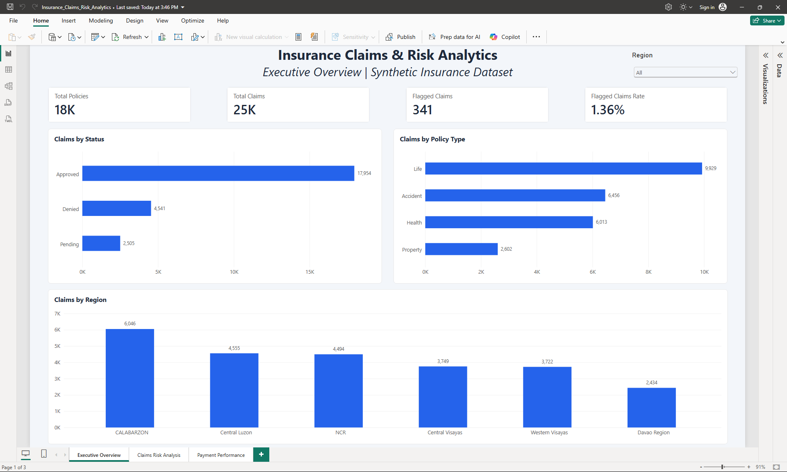
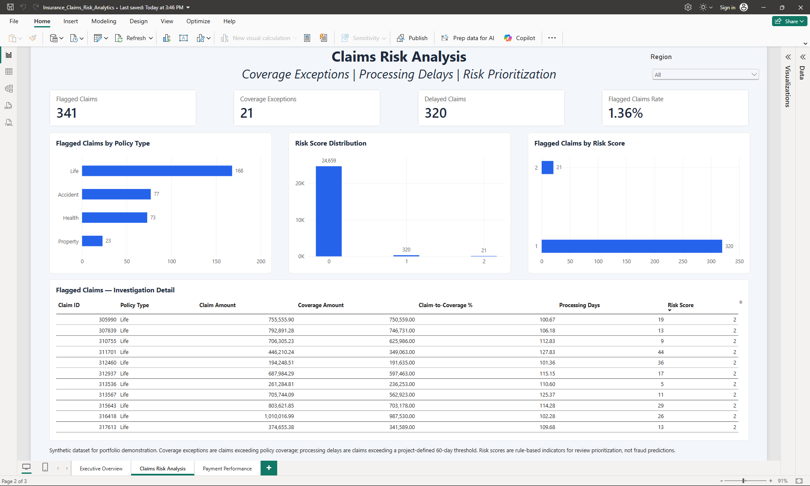
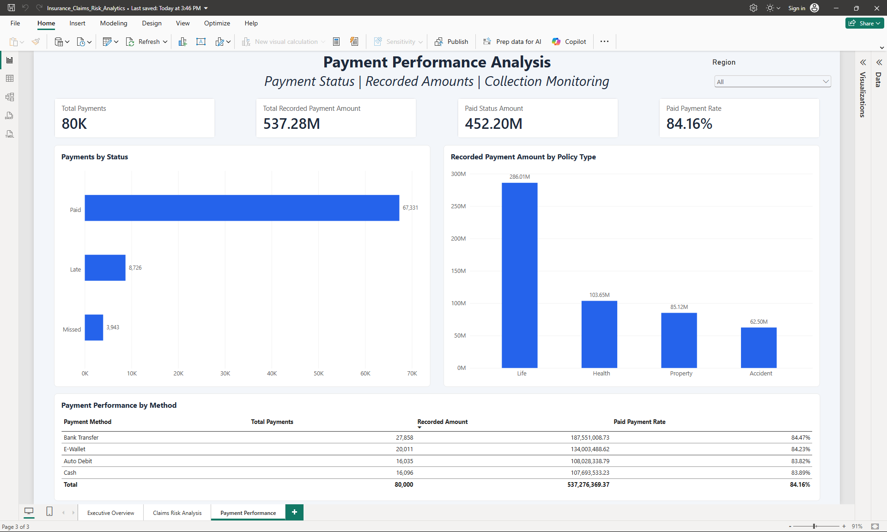

# Insurance Claims & Risk Analytics

A MySQL and Power BI portfolio project examining insurance claims, coverage exceptions, processing delays, and recorded payment activity. The workflow connects SQL data-quality checks and reusable reporting views to a three-page dashboard for business review.

**Tech stack:** MySQL 8.0+, SQL, Power BI Desktop. SQL techniques include joins, conditional aggregation, CTEs, and window functions.

## Business Questions

- Which claims exceed their policy's recorded coverage or take more than 60 processing days?
- How do review flags, claim amounts, and claim-to-coverage ratios vary by policy type?
- How do recorded payment amounts vary by status, and which payment methods are most common?

## Dataset

The project uses synthetic data for portfolio demonstration.

| Table | Records |
| --- | ---: |
| Customers | 10,000 |
| Policies | 18,000 |
| Claims | 25,000 |
| Payments | 80,000 |

## Key Findings

Reported results for the documented synthetic snapshot:

| Indicator | Result |
| --- | ---: |
| Claims exceeding recorded policy coverage | 21 |
| Claims with processing time greater than 60 days | 320 |
| Claims meeting both rules | 0 |
| **Unique flagged claims** | **341 (1.36%)** |
| Total recorded payment amount, all statuses | 537,276,369.37 |
| Recorded amount with `Paid` status | 452,200,033.15 |

**Claim status:** 17,954 Approved · 4,541 Denied · 2,505 Pending — 25,000 claims in total.

Unique flagged claims count each claim meeting either rule once: `21 + 320 - 0 = 341`. The flagged rate is `341 / 25,000 = 1.364%`, displayed as **1.36%**.

Payment amounts describe recorded activity. `Paid` is a source status label, and the amounts are not independently verified collections. Currency is unspecified.

## Review Rules

```text
coverage_exception = 1 when claim_amount > coverage_amount; otherwise 0
processing_delay   = 1 when processing_days > 60; otherwise 0
risk_score         = 2 * coverage_exception + processing_delay
```

The SQL names these indicators `coverage_exceeded_flag` and `processing_delay_flag`. Scores range from 0 (neither rule) to 3 (both rules); unique flagged counts use distinct claim IDs, not the sum of weighted scores.

The **60-day threshold and 2:1 weighting are project-defined review rules**. The score supports review prioritization and does not predict fraud. Pending and denied claims remain included in the analysis; a flag does not establish an incorrect payout.

## Dashboards

### Executive Overview

Portfolio counts, amounts, and claims review indicators.



### Claims Risk Analysis

Coverage exceptions, processing delays, risk scores, and policy-type comparisons.



### Payment Performance

Recorded payment activity, source-status distribution, and payment-method mix.



## Project Files

| File | Purpose |
| --- | --- |
| [01_data_quality.sql](sql/01_data_quality.sql) | Profile counts, keys, missing values, categories, amounts, dates, and references |
| [02_cleaned_views.sql](sql/02_cleaned_views.sql) | Define reusable reporting views |
| [03_claims_risk_analysis.sql](sql/03_claims_risk_analysis.sql) | Analyze review flags, scores, policy segments, ratios, and rankings |
| [04_payment_performance.sql](sql/04_payment_performance.sql) | Summarize recorded payments by status and method |
| [Methodology](documentation/methodology.md) | Analytical approach, definitions, assumptions, and workflow |
| [Data Dictionary](documentation/data_dictionary.md) | Tables, fields, relationships, and derived metrics |
| [Validation Notes](documentation/validation_notes.md) | Evidence scope, benchmark reconciliation, and rerun controls |
| [Power BI Report](powerbi/Insurance_Claims_Risk_Analytics.pbix) | Download the three-page report for Power BI Desktop |

## How to Explore

1. Review the dashboard screenshots and key findings above.
2. Read the methodology and SQL files to follow the analysis from profiling to reporting.
3. To rerun SQL, use an existing populated MySQL 8.0+ database named `insurance_risk_analytics` and run files **01 → 02 → 03 → 04**. Review data-quality findings and reconcile raw/view counts and distinct IDs before interpreting results. Inspect existing view definitions before running file 02.
4. Open the `.pbix` in Power BI Desktop. **Refresh requires the matching MySQL source database and views**, a reachable server, valid credentials, and compatible MySQL connection support. Update local connection settings and compare report results with SQL under the same filters.

## Scope and Limitations

- Results describe synthetic data and should not be generalized to an actual insurer.
- The repository contains analytical scripts; database setup, data-generation/import scripts, and a reproducible seed are not included. A checkout alone cannot recreate the source data.
- Review flags are descriptive rules, not fraud predictions or validated actuarial probabilities. The processing threshold is not a documented contractual service level.
- Payment-status summaries do not establish on-time collections or overdue aging without billing and settlement definitions.
- Results reflect the project owner's reported snapshot. Documentation review and arithmetic checks are separate from independent SQL execution or Power BI refresh; see the Validation Notes for evidence boundaries.
