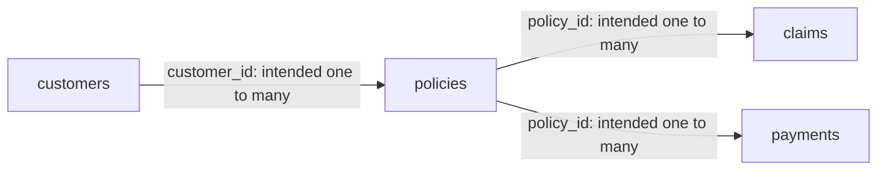

# Data Dictionary — Insurance Claims & Risk Analytics

This document describes the synthetic insurance dataset used for the project's MySQL analysis and Power BI reporting. It covers four base tables, four SQL views, relationship keys, derived fields, and interpretation limits. See [Methodology](methodology.md) for the analytical workflow and reconciliation approach.

## 1. Documentation basis and evidence status

The schema referenced by the analytical scripts is `insurance_risk_analytics`. Column names and calculations below follow the four local SQL deliverables and the established project methodology.

| Previously uploaded filename identified for this project | Repository SQL filename | Documentation basis |
| --- | --- | --- |
| `01_data_quality(2).sql` | [`01_data_quality.sql`](../sql/01_data_quality.sql) | Schema inspection, counts, key/missing-value/category checks, amount/date checks, and orphan references |
| `02_cleaned_views(1).sql` | [`02_cleaned_views.sql`](../sql/02_cleaned_views.sql) | Exact selected columns, customer transformations, claims join, and derived fields |
| `03_claims_risk_analysis(1).sql` | [`03_claims_risk_analysis.sql`](../sql/03_claims_risk_analysis.sql) | Coverage and delay rules, risk categories, denominators, bands, and rankings |
| `04_payment_performance(1).sql` | [`04_payment_performance.sql`](../sql/04_payment_performance.sql) | Payment record/status/method counts and recorded amount summaries |

**Source boundary:** The files inspected for this document were the local deliverables with the repository filenames shown above, alongside the existing methodology, source map, and SQL validation notes. The upload filenames are recorded for traceability; byte-for-byte identity with those separately named uploads was not independently established in this review. The local source map traces the consolidated package to earlier scripts named `01_data_quality.sql`, `1.sql`, and `1_1.sql`.

**Verification boundary:** This documentation review did not connect to MySQL, execute queries, inspect live DDL, or refresh Power BI. Snapshot counts and claims results below are established project figures recorded in the methodology, not new query results. SQL definitions establish code behavior, not that all data-quality checks passed.

Physical SQL data types, lengths, precision/scale, defaults, nullability, indexes, and enforced primary/foreign-key constraints are **not verified**. Identifier and relationship roles below describe intended analytical use, not declared database constraints. Logical descriptions such as date, category, amount, and identifier do not assert SQL storage types.

## 2. Tables, row grains, and known counts

| Base table | Intended row grain | Logical record identifier | Established snapshot rows |
| --- | --- | --- | ---: |
| `customers` | One customer record | `customer_id` | 10,000 |
| `policies` | One policy record | `policy_id` | 18,000 |
| `claims` | One claim record | `claim_id` | 25,000 |
| `payments` | One recorded payment row | `payment_id` | 80,000 |

These are historical project snapshot counts. They do not establish current row counts, distinct identifier counts, non-null identifiers, or enforced uniqueness. A payment row is not established as one expected premium installment, billing period, or successful settlement.

## 3. Base-table columns

Descriptions explain the project's working business meaning. Where the scripts do not define operational semantics, that uncertainty is retained. Profiling conditions identify records for investigation; they are not verified database constraints or automatic exclusions.

### 3.1 `customers`

| Column | Business meaning and analytical role | Handling and limitations |
| --- | --- | --- |
| `customer_id` | Identifier for a customer record; logical parent key for `policies.customer_id`. | Intended to identify one customer. Duplicate and null checks exist; uniqueness and constraint enforcement are not established here. |
| `join_date` | Recorded customer joining date. | Carried unchanged into the customer view. Exact onboarding event and date storage format are not specified. |
| `birth_date` | Recorded customer date of birth. | Carried unchanged. No age calculation or age eligibility rule is established by the reviewed views. |
| `gender` | Recorded customer gender category. | Raw categories are profiled. Customer view trims whitespace and converts empty/whitespace-only text to `NULL`; no allowed-value list or category remapping is established. |
| `region` | Recorded region associated with the customer, used for geographic summaries. | Null/blank values are profiled; the view leaves values unchanged. No geographic code standard, hierarchy, or residence definition is verified. |
| `province` | Recorded province associated with the customer. | Null/blank values are profiled; the view leaves values unchanged. Province-to-region consistency is not established. |
| `membership_type` | Recorded customer membership classification. | Raw values and casing are profiled. Customer view trims text, uppercases its first character, and lowercases the remainder. Membership benefits and an exhaustive category list are not defined. |
| `customer_status` | Recorded customer status category. | Profiled and passed through unchanged. Status transition rules, as-of date, and an exhaustive allowed-value list are not specified. |

### 3.2 `policies`

| Column | Business meaning and analytical role | Handling and limitations |
| --- | --- | --- |
| `policy_id` | Identifier for a policy record; logical parent key for claims and payments. | Intended to identify one policy. Duplicate/null checks exist; enforced uniqueness is not verified. |
| `customer_id` | Customer reference connecting a policy to `customers.customer_id`. | Orphan references are profiled. A foreign-key constraint and mandatory/non-null relationship are not verified. |
| `policy_type` | Recorded policy/product classification used to segment claims analysis. | Category and null/blank checks exist. Passed unchanged into the policy and claims views; no exhaustive category list is asserted. |
| `coverage_amount` | Recorded policy coverage amount used as the comparison amount and denominator in claims analysis. | Nonpositive and null values are profiled. Currency, precision, per-event versus aggregate limits, benefit sublimits, and historical coverage versions are not specified. Ratios require positive, non-null coverage. |
| `premium_amount` | Recorded policy premium amount. | Nonpositive and null values are profiled. Currency, billing frequency, covered period, tax treatment, and whether this is due or collected are not specified. It cannot alone establish expected collections. |
| `start_date` | Recorded policy start date. | Passed unchanged; null start dates and end-before-start records are profiled. Exact coverage commencement rules are not defined. |
| `end_date` | Recorded policy end date. | Compared with `start_date` for date-order checks. Inclusive/exclusive endpoint rules and meaning of missing end dates are not defined. |
| `policy_status` | Recorded policy status category. | Profiled and passed unchanged. Risk analysis does not restrict claims to a particular policy status; status history is not supplied. |

The claims join matches `policy_id` only. It does not verify that `claim_date` falls within the policy dates or that coverage was effective on that date.

### 3.3 `claims`

| Column | Business meaning and analytical role | Handling and limitations |
| --- | --- | --- |
| `claim_id` | Identifier for a claim record; used for claim detail and ranking tie-breaks. | Duplicate/null checks exist. One analytical row per claim requires unique claim IDs and unique matched policy IDs. |
| `policy_id` | Policy reference connecting a claim to `policies.policy_id`. | Orphan references are profiled. The analytical view uses an inner join, excluding claims without a matching policy. |
| `claim_date` | Recorded date associated with the claim. | Passed unchanged; null dates are profiled. The scripts do not distinguish incident, submission, receipt, adjudication, or settlement date. |
| `claim_type` | Recorded claim classification. | Null/blank values are profiled; passed unchanged. No exhaustive categories or benefit rules are established. |
| `claim_amount` | Recorded claim amount analyzed against the linked policy's coverage. | Nonpositive and null values are profiled. Currency and amount basis are not specified; this is not established as an approved amount, actual payout, or incurred loss. |
| `claim_status` | Recorded claim status used in descriptive breakdowns. | Queries explicitly compare `Approved`, `Denied`, and `Pending`; these literals are not proof of an exhaustive domain. No status filter is applied to the risk population. |
| `processing_days` | Recorded claim-processing duration expressed as days in the project rules and query labels. | Negative and null values are profiled. The delay rule is strictly `> 60`. Calendar versus business days, start/end events, treatment of open claims, and rounding are not specified; the scripts do not reconstruct duration from timestamps. |

### 3.4 `payments`

| Column | Business meaning and analytical role | Handling and limitations |
| --- | --- | --- |
| `payment_id` | Identifier for a recorded payment row. | Duplicate/null checks exist. Uniqueness and a one-to-one correspondence with actual transactions are not independently established. |
| `policy_id` | Policy reference connecting a payment row to `policies.policy_id`. | Orphan references are profiled. The payment view itself does not join to policies or exclude unmatched rows. |
| `payment_date` | Recorded date associated with the payment row. | Null dates are profiled. It is not established as a contractual due date, posting date, or bank settlement date. |
| `payment_amount` | Recorded amount attached to the payment row. | Nonpositive and null values are profiled. Currency and settlement meaning are unspecified. Summing all statuses gives recorded amounts, not independently verified cash received. |
| `payment_status` | Recorded payment status category. | Queries explicitly compare `Paid`, `Late`, and `Missed`; null/blank values and other categories require inspection. These labels do not establish due-date rules, collection success, or actual arrears. |
| `payment_method` | Recorded payment-method category used for counts. | Null/blank values and category distribution are profiled. No exhaustive method list or settlement verification is supplied. |

**Shared amount convention:** No currency, conversion rule, or monetary scale is asserted for `coverage_amount`, `premium_amount`, `claim_amount`, or `payment_amount`. The coverage comparison assumes claim and coverage amounts are comparable; cross-currency comparability is not verified. Do not label amounts PHP, USD, thousands, or millions without additional evidence.

## 4. SQL views and column lineage

All four views are defined in [`02_cleaned_views.sql`](../sql/02_cleaned_views.sql). None modifies base-table rows. The word `clean` in a name does not certify error-free data.

| View | Source and intended grain | Population and count behavior |
| --- | --- | --- |
| `vw_customers_clean` | `customers`; one output row per input customer row | No join, filter, aggregation, or deduplication. Row count equals the current raw customer count by definition; 10,000 is the established snapshot reference, not a new view count. |
| `vw_policies_clean` | `policies`; one output row per input policy row | Pass-through selection. Row count equals the current raw policy count by definition; snapshot reference is 18,000. |
| `vw_claims_analysis` | `claims c INNER JOIN policies p ON c.policy_id = p.policy_id`; one matched claim row when keys satisfy the intended grain | Unmatched claims are excluded; duplicate policy IDs can multiply claim rows. The raw 25,000-claim count is not an unconditional view-count guarantee. No fresh view count is asserted. |
| `vw_payments_clean` | `payments`; one output row per input payment row | Pass-through selection. Row count equals the current raw payment count by definition; snapshot reference is 80,000. |

### 4.1 `vw_customers_clean`

Output columns, in SQL order:

```text
customer_id, join_date, birth_date, gender, region, province,
membership_type, customer_status
```

All columns originate in `customers`. Two expressions replace the raw values under the same column names:

```sql
NULLIF(TRIM(gender), '') AS gender

CONCAT(
    UPPER(LEFT(TRIM(membership_type), 1)),
    LOWER(SUBSTRING(TRIM(membership_type), 2))
) AS membership_type
```

The membership expression normalizes casing; it does not validate a membership category. Empty/whitespace-only membership becomes empty text rather than `NULL`; a null input remains null. Region, province, and customer status are unchanged.

### 4.2 `vw_policies_clean`

Output columns, all passed unchanged from `policies`:

```text
policy_id, customer_id, policy_type, coverage_amount, premium_amount,
start_date, end_date, policy_status
```

No imputation, status mapping, date correction, filtering, or deduplication is implemented.

### 4.3 `vw_claims_analysis`

Output columns, in SQL order:

```text
claim_id, policy_id, policy_type, claim_date, claim_type, claim_amount,
coverage_amount, claim_status, processing_days, coverage_exceeded_flag,
processing_delay_flag, claim_coverage_pct, risk_score
```

| Column lineage | Output columns |
| --- | --- |
| `claims c`, unchanged | `claim_id`, `policy_id`, `claim_date`, `claim_type`, `claim_amount`, `claim_status`, `processing_days` |
| `policies p`, unchanged | `policy_type`, `coverage_amount` |
| SQL expressions | `coverage_exceeded_flag`, `processing_delay_flag`, `claim_coverage_pct`, `risk_score` |

This view does not contain `customer_id`, `premium_amount`, customer attributes, or payment fields. Customer segmentation requires the relationship through policies. No claim-status, policy-status, or date filter is applied.

### 4.4 `vw_payments_clean`

Output columns, all passed unchanged from `payments`:

```text
payment_id, policy_id, payment_date, payment_amount,
payment_status, payment_method
```

No filtering, deduplication, status mapping, or payment settlement validation is implemented.

## 5. Derived fields and analysis-only outputs

### 5.1 Fields stored in the claims view definition

| Field | SQL calculation | Meaning and boundary |
| --- | --- | --- |
| `coverage_exceeded_flag` | `CASE WHEN c.claim_amount > p.coverage_amount THEN 1 ELSE 0 END` | Binary review indicator. Equality does not trigger it. A missing comparison input falls through to zero. |
| `processing_delay_flag` | `CASE WHEN c.processing_days > 60 THEN 1 ELSE 0 END` | Binary review indicator for more than 60 recorded days. Exactly 60 does not trigger it; a null duration falls through to zero. |
| `claim_coverage_pct` | `c.claim_amount / p.coverage_amount * 100` | Claim amount as a percentage of linked policy coverage; 100 represents equality. Requires valid claim amounts and positive, non-null coverage. The view does not add `NULLIF`, a validity filter, or display rounding. Division by zero can produce null/warnings or errors depending on runtime context; it must be resolved before interpretation. |
| `risk_score` | `2 * coverage_exceeded_flag + processing_delay_flag` (equivalent to the two `CASE` expressions used in SQL) | Project review-priority score from 0 to 3, with coverage weighted 2 and delay weighted 1. No monetary or probability unit; not a validated fraud probability or actuarial risk estimate. |

Null comparisons do not evaluate as true in these `CASE` rules. Consequently, a zero flag or score does not demonstrate complete inputs or absence of other risks. The thresholds and weights are project rules, not documented contractual service levels or regulatory standards.

### 5.2 Query outputs that are not additional view columns

| Output / alias | Definition and interpretation |
| --- | --- |
| `risk_category` | Score 0 → `No Flag`; 1 → `Processing Flag`; 2 → `Coverage Flag`; 3 → `Multiple Flags`. Produced by the claims analysis query, not persisted as a claims-view column. |
| `flagged`, `total_flagged`, `flagged_claims` | Indicators/counts for coverage exceeded **OR** processing delay. Count a claim meeting both rules once, provided one row per claim is established. SQL row sums are not inherently distinct-ID counts. |
| `coverage_flags`, `processing_flags` | Query-level aliases for the separate coverage/delay indicators or their grouped sums. They do not add new business rules. |
| `excess_amount` | `claim_amount - coverage_amount`, restricted to claims exceeding coverage; uses the same unspecified monetary unit as the inputs. |
| `processing_time_group` | Ordered bands: `0-15 days`, `16-30 days`, `31-60 days`, `61-90 days`, `Over 90 days` (SQL labels include numeric sort prefixes). Boundaries use successive `<=` comparisons. Null durations fall into the final band; negative durations enter the first. Interpret only after input validation. |
| `claim_coverage_group` | Ordered bands: `0-25%`, `>25-50%`, `>50-75%`, `>75-100%`, `>100%` (with numeric sort prefixes). Null ratios enter the final band; negative ratios enter the first. |
| `claim_rank` | `ROW_NUMBER()` within policy type, ordered by claim amount descending and then `claim_id`; top-three output retains ranks `<= 3`. |
| `ratio_rank` | `ROW_NUMBER()` within policy type, ordered by full-precision claim-to-coverage percentage descending and then `claim_id`; display rounding occurs after ranking. |
| `avg_claim_to_coverage_pct` | `AVG(claim_amount / coverage_amount) * 100`, rounded for display. Average of row-level ratios, not a ratio of totals or premium-based loss ratio. |
| `max_claim_to_coverage_pct` | Maximum claim-level ratio multiplied by 100, rounded for display. |
| `flag_rate_percentage` | Flagged matched rows divided by all matched claim rows within the policy type, multiplied by 100 and rounded to two decimals. |
| `pct_of_policy_claims` | Ratio-band row count divided by all matched claim rows within that policy type, multiplied by 100 and rounded to two decimals. |

Each represented policy type contributes up to three rows to a top-three output. A fixed total of 12 rows is not guaranteed. Average coverage in a claim-to-policy join is weighted by the number of claims per policy, rather than being an unweighted policy average.

## 6. Logical relationships and join controls



| Parent → child | Join expression | Business interpretation |
| --- | --- | --- |
| `customers` → `policies` | `customers.customer_id = policies.customer_id` | A customer may be associated with multiple policy records. |
| `policies` → `claims` | `policies.policy_id = claims.policy_id` | A policy may be associated with multiple claim records. |
| `policies` → `payments` | `policies.policy_id = payments.policy_id` | A policy may be associated with multiple recorded payment rows. |

These are intended one-to-many relationships. Child references, parent uniqueness, actual cardinality, and optionality must be validated; enforced database constraints are not confirmed. The diagram does not establish exact Power BI relationship settings, active/inactive state, or filter direction.

- Check duplicate and null identifiers separately. `COUNT(*) - COUNT(DISTINCT id)` includes null-ID rows as well as repeated non-null IDs.
- Check orphan references before relying on the claims inner join. Matching counts alone can conceal excluded claims offset by multiplied rows.
- The claims view joins the raw `policies` table, not `vw_policies_clean`; the latter currently passes through the same columns.
- Do not directly join claim and payment detail on `policy_id` for combined totals. Multiple claims and payment rows per policy create a many-to-many expansion. Aggregate each fact to the required reporting grain before combining.
- C03 in the claims script groups by `claim_id` while selecting other nonaggregated columns. Runtime compatibility depends on actual key declarations and SQL mode; intended uniqueness alone does not establish compatibility.

## 7. Counts, measures, and business interpretation

### 7.1 Established claims snapshot

The existing methodology records the following as project-owner-confirmed SQL-to-Power BI reconciliation. They were not independently rerun for this dictionary.

| Indicator | Established count |
| --- | ---: |
| Claims exceeding coverage | 21 |
| Claims over 60 processing days | 320 |
| Claims meeting both rules | 0 |
| Unique flagged claims | 341 |

The arithmetic reconciliation is `21 + 320 - 0 = 341`. This check supports internal consistency of the reported figures; it does not establish current database state or all-query validation.

### 7.2 Population and denominator rules

| Measure | Population / meaning |
| --- | --- |
| Raw claim count and claim-status percentages | All raw `claims` rows; status percentage denominator is all raw claims. |
| C02 coverage-exception percentage | Numerator uses claims matched to policies; denominator uses all raw claims. |
| View-based risk summaries | Matched claim rows in `vw_claims_analysis`; may differ from the raw claim population. |
| Unique flagged claims | Conceptually distinct claim IDs meeting either rule. SQL flag sums/row counts equal this only when IDs and joins preserve one row per claim. |
| Total claim amount | Sum of recorded claim amounts in the selected population, including statuses present; not established cash paid or incurred losses. |
| Average processing days | Average of non-null recorded durations in the selected population. |
| Payment-status percentage | Rows in the status divided by all raw payment rows; not an on-time payment rate. |
| `total_recorded_payment_amount` / `total_recorded_amount` | Sum of recorded payment amounts across all statuses; not verified collections. |
| `paid_status_amount` | Sum of amounts on rows matching the source literal `Paid`; no independent settlement confirmation. |
| `late_status_amount` | Sum of amounts on rows matching `Late`; eventual receipt and lateness duration are not established. |
| `missed_status_amount` | Sum of amounts on rows matching `Missed`; not a verified outstanding balance or arrears measure. |

Other/null payment statuses can make the three named status amounts differ from total recorded amount. Actual category values and collation affect literal comparisons; the literals in queries do not prove an exhaustive allowed-value list. `SUM` and `AVG` ignore null amounts, and `SUM` over an empty set can return null. Rounded percentages may not sum to exactly 100%.

## 8. Known limitations and unresolved metadata

- **Synthetic data:** Counts and exception rates demonstrate portfolio methods and should not be generalized to an actual insurer. The reviewed analytical package does not supply a complete data-generation/import process or random seed.
- **Physical schema:** Obtain actual schema metadata before documenting SQL types, precision/scale, nullability, defaults, keys, indexes, or constraints as verified. The schema-inspection query in the quality script is not itself a saved result.
- **Categories and dates:** Exhaustive domains, status transitions, reporting period/cutoff, date storage formats, and operational event definitions are not supplied. No date or claim-status filter is applied to the risk population.
- **Amounts and coverage:** Currency and monetary scale are unspecified. A claim above recorded coverage is a review signal, not proof of an incorrect payout, fraud, or regulatory breach. Eligibility, benefit sublimits, and effective-dated coverage are not evaluated.
- **Durations and flags:** Calendar/business-day convention and duration event boundaries are unknown. Missing inputs can produce zero flags; invalid values can enter misleading distribution bands.
- **Payment interpretation:** Due dates, billing periods/frequency, amounts due, reporting cutoff, and settlement/status rules are not supplied. On-time rates, overdue aging, collection rates, and policy-level premium reconciliation cannot be established from these scripts. Monthly trends and segment payment analysis are also absent from the reviewed package.
- **View scope:** Customer normalization is limited to gender trimming/blank-to-null handling and membership casing. Policy/payment views do not remediate data. No view deduplicates records.
- **Runtime evidence:** Historical counts are not current execution outputs. No new claim totals, payment amounts, status proportions, schema validation, or dashboard refresh is asserted by this document.

For a future refresh, retain the schema export, dataset snapshot identifier, raw/view row and distinct-ID counts, null/duplicate/orphan results, warnings, and SQL-to-dashboard comparisons under equivalent filters. Update this dictionary when those records establish additional metadata or revised semantics.
