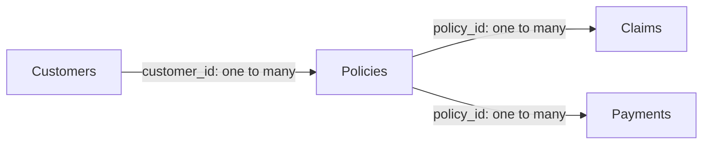

# Methodology — Insurance Claims & Risk Analytics

This portfolio uses MySQL and Power BI to examine a synthetic insurance dataset, identify claims that meet defined review rules, and summarize recorded payment activity. The workflow connects data-quality checks, reusable SQL views, claims analysis, and dashboard reporting.

**Evidence status:** Project dimensions, dashboard structure, and the claims reconciliation below are confirmed by the project owner. The supplied SQL package and `VALIDATION_NOTES.md` were reviewed statically when preparing this document; no database connection, SQL execution, or Power BI refresh was performed during that review. User-confirmed reconciliation and static code checks are separate forms of evidence.

## 1. Scope and analytical questions

The analysis addresses four questions:

- Which claims exceed their policy's recorded coverage amount?
- Which claims have more than 60 recorded processing days?
- How do these flags, claim amounts, and claim-to-coverage ratios vary by policy type?
- How are recorded payment rows and amounts distributed across source statuses and payment methods?

The scope is descriptive analysis and rule-based review prioritization. Flags do not establish fraud, an incorrect payout, or a regulatory breach. The processing threshold and score weights are project rules, not validated predictive parameters or documented contractual service levels.

No claim-status or date filter is applied to the SQL risk population. Pending and denied claims therefore remain eligible for flags. No reporting period, currency, or conversion rule is inferred where it is not documented.

## 2. Data and analytical grain

The source database is `insurance_risk_analytics`.

| Base table | Established row count | Intended grain | Relationship keys |
| --- | ---: | --- | --- |
| `customers` | 10,000 | One customer record | `customer_id` |
| `policies` | 18,000 | One policy record | `policy_id`, `customer_id` |
| `claims` | 25,000 | One claim record | `claim_id`, `policy_id` |
| `payments` | 80,000 | One recorded payment row | `payment_id`, `policy_id` |

These are the established project snapshot counts, not fresh counts produced for this document. Key uniqueness and referential integrity must be checked before treating the intended grain as guaranteed.

The dataset is synthetic and supports portfolio demonstration. Its distributions and exception rates should not be generalized to an actual insurer. Dataset-generation scripts, a random seed, and a complete database build/import package were not supplied with the reviewed analytical SQL.

## 3. Workflow and data-quality checks

The SQL is organized into four files, executed in order against an existing populated database:

| Step | Repository file | Purpose |
| --- | --- | --- |
| 1 | [`sql/01_data_quality.sql`](sql/01_data_quality.sql) | Inspect schema, record counts, keys, missing values, categories, amounts, dates, and references |
| 2 | [`sql/02_cleaned_views.sql`](sql/02_cleaned_views.sql) | Define four reporting views and inspect their populations |
| 3 | [`sql/03_claims_risk_analysis.sql`](sql/03_claims_risk_analysis.sql) | Analyze coverage exceptions, delays, overlaps, scores, policy segments, ratios, and rankings |
| 4 | [`sql/04_payment_performance.sql`](sql/04_payment_performance.sql) | Summarize payment status/method mix, record counts, and recorded amounts |

Data-quality profiling covers duplicate identifiers; null and blank customer fields; category values and membership casing; nonpositive coverage, premium, claim, and payment amounts; policy end dates before start dates; missing or invalid processing-day inputs; and orphan relationships between customers, policies, claims, and payments. Additional checks explicitly labeled `NEW` in DQ06 address selected null key, monetary, and date inputs.

These checks identify issues; they do not automatically correct or remove records. A nonpositive-amount comparison alone does not detect a null amount. Parent-key uniqueness must be checked before interpreting join-based orphan counts. The package is not an exhaustive data-quality framework, and this document does not assert that every check returned zero exceptions.

### Cleaning and view transformations

| View | Implemented transformation | Boundary |
| --- | --- | --- |
| `vw_customers_clean` | Applies `NULLIF(TRIM(gender), '')`; trims membership text and converts its first letter to uppercase and the remainder to lowercase | Blank membership remains blank; region, province, and customer status are unchanged |
| `vw_policies_clean` | Selects policy fields without transformation | No filtering, deduplication, imputation, or normalization |
| `vw_claims_analysis` | Inner-joins claims to policies; adds policy type, coverage, two flags, claim-to-coverage percentage, and risk score | Unmatched claims are excluded; duplicate policy keys can multiply claim rows |
| `vw_payments_clean` | Selects payment fields without transformation | No filtering, deduplication, status mapping, or settlement verification |

The word `clean` in a view name does not certify error-free data. These views preserve the base-table records. The packaged DDL uses `CREATE VIEW`, so an existing view with the same name causes an error instead of being overwritten. Existing definitions must be inspected separately.

## 4. Claims rules and KPI definitions

For a claim with valid inputs:

```text
coverage_exceeded_flag = 1 when claim_amount > coverage_amount; otherwise 0
processing_delay_flag  = 1 when processing_days > 60; otherwise 0
risk_score             = 2 * coverage_exceeded_flag + processing_delay_flag
flagged claim          = coverage_exceeded_flag = 1 OR processing_delay_flag = 1
claim_coverage_pct     = claim_amount / coverage_amount * 100
```

The boundaries are strict: an amount equal to coverage is not a coverage exception, and exactly 60 processing days is not a delay flag.

| Score | SQL category | Interpretation |
| ---: | --- | --- |
| 0 | No Flag | Neither rule met |
| 1 | Processing Flag | Delay rule only |
| 2 | Coverage Flag | Coverage rule only |
| 3 | Multiple Flags | Both rules met |

Missing inputs require separate review. In the supplied `CASE` expressions, null comparisons fall through to a zero flag. A score of zero therefore does not prove complete data or absence of other risks.

| KPI | Definition and population |
| --- | --- |
| Total claims | Raw claim count for source profiling; matched claim count for `vw_claims_analysis` summaries |
| Total claim amount | Sum of recorded claim amounts in the selected population; not established paid claims or incurred losses |
| Coverage exceptions | Claims where amount exceeds linked policy coverage |
| Delayed claims | Claims with recorded `processing_days > 60` |
| Unique flagged claims | Distinct claim IDs meeting either rule; a claim meeting both is counted once |
| Flag rate by policy type | Flagged matched claims divided by all matched claims within that policy type |
| Average processing days | Average of non-null recorded processing days in the selected population |
| Claim-to-coverage percentage | Claim amount divided by linked policy coverage, multiplied by 100; requires positive, non-null coverage |
| Coverage excess amount | `claim_amount - coverage_amount`, restricted to coverage exceptions |

**Denominator control:** C02 in the supplied claims script divides matched coverage exceptions by **all raw claims**. Other risk summaries use matched claims. These populations agree only after join reconciliation. SQL row counts and distinct claim counts agree only when the analytical view contains one row per claim.

The policy-type average ratio is `AVG(claim_amount / coverage_amount) * 100`, not a ratio of aggregate amounts. Average policy coverage in this joined analysis is weighted by claim frequency. Neither measure is a premium-based insurance loss ratio.

Processing bands are 0–15, 16–30, 31–60, 61–90, and over 90 days. Ratio bands are 0–25%, >25–50%, >50–75%, >75–100%, and >100%. The retained SQL sends null processing days to the final processing band and null ratios to the final ratio band; negative values enter the first band. Resolve invalid inputs before interpreting these distributions.

Top-three analyses use `ROW_NUMBER()` within each represented policy type, with `claim_id` as the tie-breaker. Ratio rankings use full precision before display rounding. Each type contributes up to three rows; a fixed total of 12 rows is not guaranteed.

## 5. Power BI model and reporting

The established Power BI relationship structure follows the source keys:



The reporting tables correspond to the four SQL views. The model keeps claims and payments as separate facts linked through policies. A direct claim/payment join on `policy_id` can multiply both facts when a policy has multiple claims and payment rows. For combined analysis, aggregate each fact to the intended reporting grain before joining.

The three report pages organize the analysis as follows:

| Page | Analytical focus |
| --- | --- |
| Executive Overview | Portfolio-level counts, amounts, and claims review indicators |
| Claims Risk Analysis | Coverage and processing flags, scores, policy-type comparisons, ratios, and exception detail |
| Payment Performance | Recorded payment activity, source-status distribution, and payment-method mix |

Power BI uses a unique flagged-claim definition rather than adding the two flag counts. The following is an **equivalent reference measure**, using SQL view names; it is not a verbatim extraction of the saved report's DAX:

```dax
Flagged Claims (Unique) =
CALCULATE (
    DISTINCTCOUNT ( 'vw_claims_analysis'[claim_id] ),
    KEEPFILTERS (
        'vw_claims_analysis'[coverage_exceeded_flag] = 1
            || 'vw_claims_analysis'[processing_delay_flag] = 1
    )
)
```

Claim IDs must be non-null and unique at the intended grain. Reconciliation requires equivalent SQL and dashboard filters. The `.pbix` model was not inspected or refreshed for this document; exact imported table names, measure text, active relationships, filter directions, and slicer behavior require verification in Power BI Desktop.

## 6. Payment-status semantics

The payment script summarizes one recorded payment row at a time. It reports status percentages, method counts, distinct payment IDs, policies with payment records, total recorded amounts, and conditional amounts for the source labels `Paid`, `Late`, and `Missed`.

| Output | Supported interpretation |
| --- | --- |
| Payment count | Number of recorded rows; not necessarily the number of expected premium installments |
| Payment-status percentage | Rows in a status divided by all raw payment rows |
| Total recorded payment amount | Sum across all statuses; not verified cash received |
| Paid-status amount | Sum of recorded amounts labeled `Paid`; no independent settlement verification |
| Late-status amount | Sum of recorded amounts labeled `Late`; does not establish whether cash was eventually received |
| Missed-status amount | Sum of recorded amounts labeled `Missed`; does not establish actual arrears or an outstanding balance |

The three named status sums need not equal the total if other or null statuses exist. Category values and database collation must be inspected before relying on literal status comparisons. `SUM` and `AVG` ignore null inputs; `SUM` over an empty set can return null. Rounded percentages can differ slightly from 100% in total.

Due dates, billing periods/frequency, amounts due, reporting cutoff, and settlement/status rules were not supplied. Consequently, the reviewed SQL does not establish an on-time payment rate, overdue aging, expected-versus-paid collection rate, or a policy-level premium reconciliation. `premium_amount` alone is insufficient. Monthly trends and segment payment analysis are also absent from the reviewed scripts; they remain possible extensions rather than completed analyses.

## 7. Validation and reconciled results

### User-confirmed claims reconciliation

The project owner confirmed that SQL results were reconciled with the Power BI claims indicators for the established snapshot:

| Check | Confirmed count |
| --- | ---: |
| Coverage exceptions | 21 |
| Claims over 60 processing days | 320 |
| Claims meeting both conditions | 0 |
| Unique flagged claims | 341 |

The counts satisfy the inclusion–exclusion check:

```text
unique flagged claims = coverage exceptions + delayed claims - overlap
                      = 21 + 320 - 0
                      = 341
```

Using the established 25,000-claim population, the corresponding arithmetic rates are **0.084% coverage exceptions**, **1.280% delayed**, and **1.364% uniquely flagged**. These rates are derived from the confirmed counts; they are not additional database execution evidence. Any dashboard rate must use the same population and filter context.

### Static review and runtime evidence

The supplied `VALIDATION_NOTES.md` records static review of the SQL package, not executed result validation. Its statement that execution was unconfirmed describes that package review. The owner's separate SQL reconciliation confirmation is retained above without claiming an independent rerun, a saved execution log, or complete payment validation.

The static review covered section/source mapping, preserved extracted query text, four view definitions, allowed statement types, delimiter/quote structure, and source hashes. These checks do not constitute MySQL parsing, runtime validation, or proof that all data-quality checks passed.

For a repeatable validation run, retain evidence of:

1. Raw and view row counts, distinct IDs, null IDs, duplicate keys, and orphan references.
2. Claim-to-policy join reconciliation, including excluded or multiplied rows.
3. Separate coverage, delay, overlap, and unique flagged counts from the same population.
4. SQL-to-Power BI comparisons with the same filters, alongside active relationships and refresh state.
5. Payment totals and status breakdowns, including other/null categories and their agreed business meanings.

No payment amount totals, status proportions, or collection conclusions are asserted here without supplied results.

## 8. Reproducibility requirements

To rerun the analytical workflow:

1. **Prepare the environment.** Use MySQL 8.0+ for the CTEs and window functions, a compatible SQL client, and Power BI Desktop with the required MySQL connection support.
2. **Provide the source database.** Obtain the matching synthetic data and schema definitions, including column types, keys, and constraints. The four analytical scripts do not create/import the database or regenerate its data.
3. **Confirm configuration and access.** Verify MySQL version, SQL mode, character set/collation, and the `insurance_risk_analytics` schema name. Use `SELECT` access and `CREATE VIEW` permission for step 2. Review existing views before running the DDL.
4. **Run and resolve profiling checks.** Execute `01_data_quality.sql`, retain outputs, and document any handling of invalid or missing data. Do not treat the view definitions as automatic remediation.
5. **Create or inspect views.** Execute `02_cleaned_views.sql` where names are available, or inspect existing definitions. Reconcile raw/view populations before analysis.
6. **Run the analysis.** Execute `03_claims_risk_analysis.sql` and `04_payment_performance.sql`. Save result exports, warnings, and the dataset snapshot identifier. Confirm that C03's nonaggregated columns grouped by `claim_id` are compatible with the actual enforced key and SQL mode.
7. **Refresh Power BI.** Open `powerbi/Insurance_Claims_Risk_Analytics.pbix`, configure local connection settings, inspect relationships and measure definitions, and refresh. Compare dashboard outputs with SQL under identical filters.
8. **Preserve the run record.** Record tool versions, execution/refresh time, dataset version, any deviations from the scripts, and reconciliation outputs. Use those records to distinguish reproduced results from historical results.

The query workflow is documented, but exact end-to-end reproduction requires the matching database/data snapshot and runtime configuration. No unavailable generation script, seed, execution output, or refresh record is implied.

## 9. Limitations and interpretation

- Synthetic results demonstrate analytical methods rather than real insurance performance.
- Coverage comparisons use recorded policy coverage; the SQL does not establish eligibility, benefit sublimits, coverage history at claim date, or actual payout amounts.
- Processing days are supplied values; their operational meaning and calculation are not independently reconstructed from workflow timestamps.
- Rule weights prioritize review; there is no trained model, labeled fraud target, out-of-sample evaluation, or predictive accuracy claim.
- Missing inputs, invalid ratios, joins, duplicate keys, status definitions, and filter context can change results. A zero flag is not a data-completeness guarantee.
- Payment status labels and recorded amounts support descriptive reporting only until billing and settlement definitions are established.
- User-confirmed claims reconciliation does not establish that every query, payment KPI, or dashboard interaction has been independently tested.

### Documentation basis

This methodology draws on the four supplied SQL deliverables, `VALIDATION_NOTES.md`, the package's source map and static-check record, the established Power BI structure, and the project owner's confirmed claims reconciliation. SQL comments and validation notes describe code-review provenance; confirmed project results are identified separately in Section 7.
